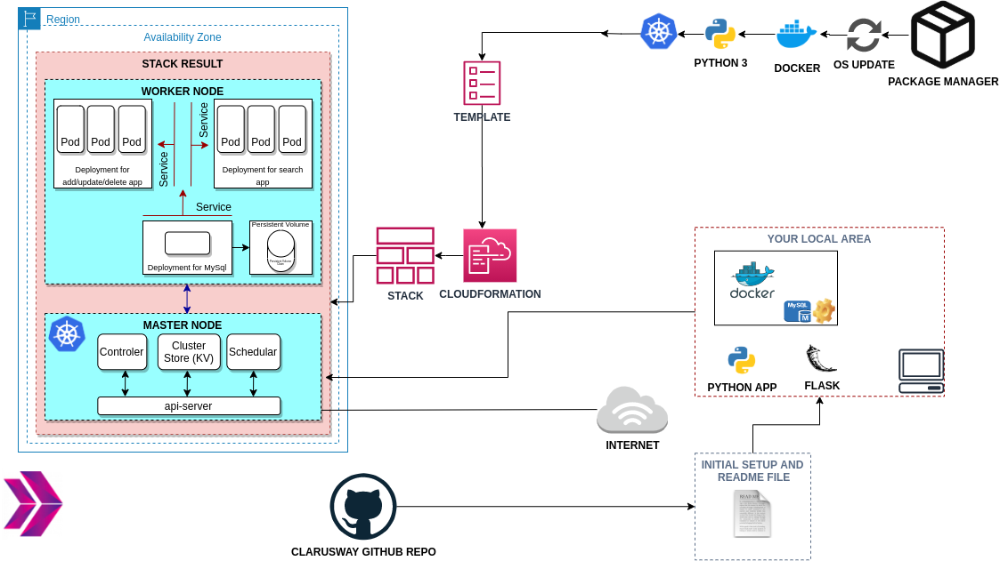
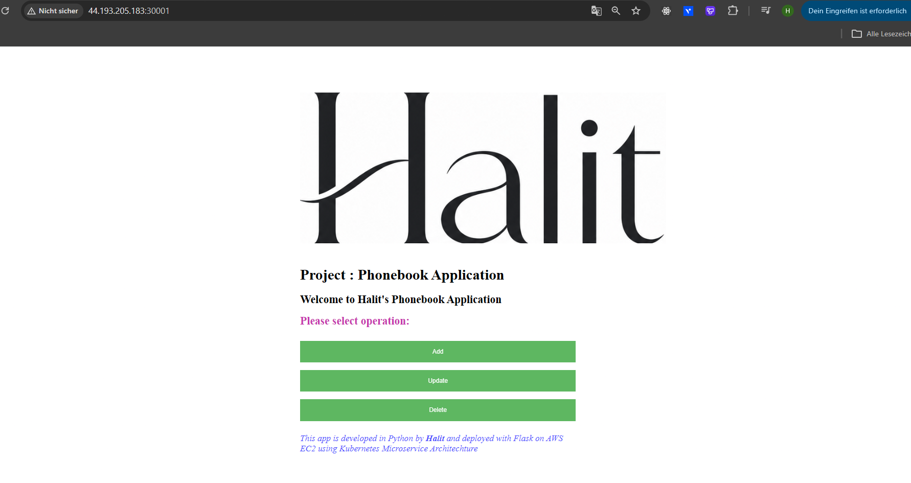
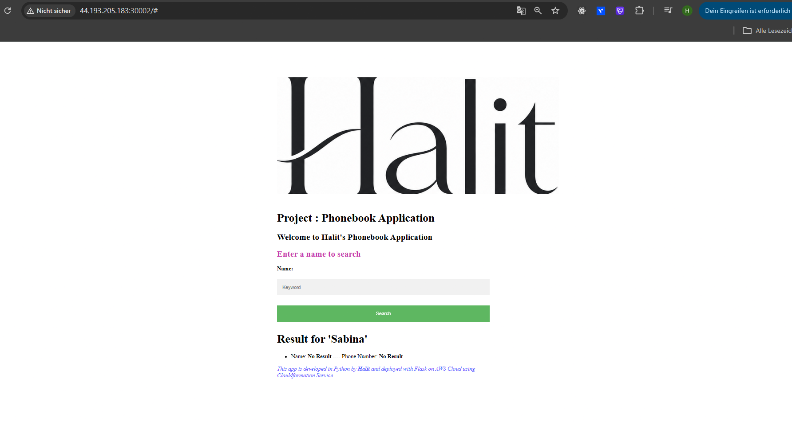

# Kubernetes Microservice Phonebook

This project runs a phonebook application as two separate Flask applications and a MySQL database, using Docker images and Kubernetes resources. The applications are built as separate Docker images and Kubernetes Deployments; both connect to the same MySQL database (`phonebook`) in the cluster.

## Architecture

```text
Browser
  ├── NodePort :30001 → webserver Service → webserver Deployment
  │                                      └── add / update / delete
  └── NodePort :30002 → resultserver Service → resultserver Deployment
                                         └── search by name
                         Both applications ──→ mysql-svc:3306
                                                   └── MySQL: phonebook
                                                       └── PVC → PV
```

- **webserver**: Provides the home page and supports adding, updating, and deleting contacts.
- **resultserver**: Searches the phonebook by name and displays `No Result` when there are no matches.
- **MySQL**: The shared database used by both applications. Data is persisted through `mysql-pvc` and `mysql-pv`.
- **Kubernetes Services**: MySQL is available inside the cluster at `mysql-svc:3306`. The web applications are exposed externally as `NodePort` services on ports `30001` and `30002`.
- `Microservice_structure.png` contains the project's architecture diagram.



## Screenshots

The images in `outputs_after_deploy/` show that the applications were reachable in a browser after deployment. The IP address shown in the screenshots is an example from the deployment and may differ in your cluster.

### Phonebook operations — webserver



Example URL shown in the screenshot: `http://44.193.205.183:30001`

### Phonebook search — resultserver



Example URL shown in the screenshot: `http://44.193.205.183:30002`. The screenshot shows no matching contact for the search term `Sabina`.

## Repository structure

```text
.
├── Microservices_App/
│   ├── image_for_web_server/       # Flask CRUD application and Dockerfile
│   └── image_for_result_server/    # Flask search application and Dockerfile
├── outputs_after_deploy/           # Screenshots taken after deployment
├── ingress.yaml
├── mysql-*.yaml                    # MySQL Deployment, Service, and persistent storage
├── servers-configmap.yaml          # Database connection settings for the applications
├── shared-secret.yaml              # Kubernetes Secret for database passwords
├── webserver-*.yaml                # Webserver Deployment and Service
└── resultserver-*.yaml             # Resultserver Deployment and Service
```

## Build and push Docker images to Docker Hub

Build each image from its application directory, using the repository root as the working directory:

```bash
docker build -t halitcamdev/web-server:1.0.0 ./Microservices_App/image_for_web_server
docker build -t halitcamdev/result-server:1.0.0 ./Microservices_App/image_for_result_server

docker login
docker push halitcamdev/web-server:1.0.0
docker push halitcamdev/result-server:1.0.0
```

The Kubernetes Deployment manifests use these image names and the `1.0.0` tag: `halitcamdev/web-server:1.0.0` and `halitcamdev/result-server:1.0.0`.

## Deploy to Kubernetes

First, make sure `kubectl` is connected to the target cluster. Then apply the resources in the following order:

```bash
# Database connection settings and Secret
kubectl apply -f mysql-configmap.yaml
kubectl apply -f servers-configmap.yaml
kubectl apply -f shared-secret.yaml

# MySQL persistent storage, Service, and Deployment
kubectl apply -f mysql-pv.yaml
kubectl apply -f mysql-pvc.yaml
kubectl apply -f mysql-svc.yaml
kubectl apply -f mysql-deployment.yaml

# Applications and externally accessible Services
kubectl apply -f webserver-deployment.yaml
kubectl apply -f webserver-svc.yaml
kubectl apply -f resultserver-deployment.yaml
kubectl apply -f resultserver-svc.yaml
```

Check the status of the resources:

```bash
kubectl get pods
kubectl get deployments
kubectl get services
kubectl get pvc
```

Once the pods are ready, use an accessible node IP with the NodePorts:

```text
http://<NODE-IP>:30001   # webserver
http://<NODE-IP>:30002   # resultserver
```

For clusters hosted in the cloud, make sure the relevant firewall or security group rules allow TCP traffic on ports `30001` and `30002`.

## Configuration

The applications receive their database connection settings through Kubernetes environment variables:

- `MYSQL_DATABASE_HOST`: `mysql-svc`
- `MYSQL_DATABASE`: `phonebook`
- `MYSQL_USER`: `clarus`
- `MYSQL_PASSWORD`: Password provided by `shared-secret`
- MySQL root password: `MYSQL_ROOT_PASSWORD` provided by `shared-secret`

The webserver creates the `phonebook` table when it starts. Persistent storage is configured in `mysql-pv.yaml` with `20Gi`, `ReadWriteOnce`, and `hostPath: /mnt/data`. Because `hostPath` uses a node's local disk, it should be replaced with a suitable StorageClass or volume solution for multi-node or production environments.

## Security and deployment notes

- Values in `shared-secret.yaml` are Base64-encoded in the Kubernetes Secret format; Base64 is not encryption. Change the passwords before using this setup and use an appropriate secret-management solution instead of storing secrets in source code.
- The Deployments use the default single-pod replica count. Resource limits and MySQL readiness/liveness probes are defined in the manifests.
